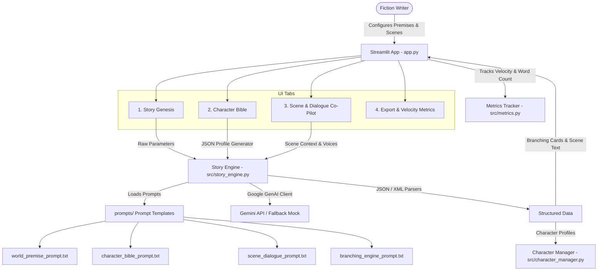

# ✍️ Creative Writing Assistant & Narrative Branching Engine

A production-grade Python (Streamlit) web application and prompt engineering pipeline designed to help fiction writers overcome creative blocks and accelerate draft generation by **3x** through structured prompt chaining, character voice enforcement, and multi-path scene branching.

---

## 🌟 Key Features

1. **Story Genesis Engine**: Configures genre, tone, and seed concepts to synthesize high-concept premises, thematic conflicts, world rules, and high-stakes plot hooks while enforcing strict **anti-cliché negative constraints**.
2. **Psychological Character Bible**: Generates and manages character sheets with strict voice constraints (vocabulary register, speech tics, signature phrases, want vs. need, fatal flaw) in valid JSON format. Outputs token-efficient XML snippets for context injection.
3. **Scene & Dialogue Co-Pilot**: Interactive writing environment that injects character voice constraints and enforces realistic, subtext-rich dialogue with few-shot in-context learning.
4. **Narrative Branching Engine ("Break Writer's Block")**: Dynamically analyzes current scene context and generates 3 distinct narrative paths forward:
   - **Escalation**: Doubles immediate stakes, physical danger, or urgency.
   - **Complication**: Introduces unexpected obstacles, secrets, or third-party interference.
   - **Reversal**: Delivers sharp paradigm shifts, betrayals, or thematic paradoxes.
5. **Drafting Velocity Metrics**: Real-time tracking of words generated, unblock sessions resolved, branching paths applied, and calculated drafting velocity multiplier.
6. **Export Suite**: Single-click manuscript and character bible export in clean Markdown (`.md`) or Plain Text (`.txt`).
7. **Zero-Config Fallback Mock Engine**: Seamlessly operates in deterministic mock mode if no API key is provided, ensuring instant testing and demo readiness out of the box.

---

## 🏗️ Architecture & Component Design



---

## 🎯 Prompt Engineering Techniques Implemented

### 1. XML Tag Delimiters & Enclosures
Prompts utilize explicit XML tags (`<character_voice>`, `<scene_context>`, `<guidelines>`, `<dialogue_goal>`) to isolate prompt instructions from user inputs and character state data. This prevents context bleeding and ensures the LLM never drops character voice constraints.

```xml
<character_voice name="Elena Rostova" role="Protagonist">
  <register>Academic / Clinical</register>
  <speech_tics>Uses precise technical timestamps, Pauses abruptly before agreeing</speech_tics>
  <signature_phrases>"Check the hash signature."; "Unverified data is poison."</signature_phrases>
  <fatal_flaw>Compulsive obsession with verifying truth</fatal_flaw>
  <voice_guidelines>Speaks with sharp, measured precision. Never uses slang or filler words.</voice_guidelines>
</character_voice>
```

### 2. Negative Constraints (Anti-Cliché Rules)
System instructions explicitly define forbidden tropes to prevent formulaic AI writing:
- *Forbidden:* "The Chosen One who doesn't know their power"
- *Forbidden:* "Ancient prophetical awakening"
- *Forbidden:* "Passive protagonist forced into action"
- *Forbidden:* "Generic shadowy syndicate without clear motives"

### 3. In-Context Few-Shot Learning (Subtext Dialogue)
`scene_dialogue_prompt.txt` embeds side-by-side contrastive examples to steer the model away from "on-the-nose" emotional confessions toward subtext-driven dialogue and action beats:

```xml
<in_context_learning>
<example_bad>
"I know you stole the money, Arthur, and I'm very angry!"
</example_bad>

<example_good>
Arthur kept his eyes locked on the ledger. "Balances check out, Elena."
Elena set her cold mug down on his stack of unfiled receipts. "Funny how receipts walk when the door's unlocked, Arthur."
</example_good>
</in_context_learning>
```

### 4. Structured Output Parsing (JSON & XML)
- **Character Sheets:** Enforced via JSON schema prompts and parsed with Pydantic for validation.
- **Narrative Branches:** Wrapped inside `<branch_option type="...">` tags containing `<title>`, `<summary>`, `<dramatic_tension>`, `<dialogue_starter>`, and `<consequence>`.

---

## 📂 Project Directory Structure

```
.
├── .env.example                # Environment variable template
├── requirements.txt            # Python dependencies
├── README.md                   # Technical documentation
├── app.py                      # Interactive Streamlit Web Dashboard
├── prompts/                    # Production Prompt Engineering Templates
│   ├── world_premise_prompt.txt
│   ├── character_bible_prompt.txt
│   ├── scene_dialogue_prompt.txt
│   └── branching_engine_prompt.txt
└── src/                        # Core Engine Modules
    ├── __init__.py
    ├── story_engine.py         # LLM & Mock Execution Engine
    ├── character_manager.py    # Character Bible & Voice Snippet Manager
    └── metrics.py              # Velocity Metrics Tracker
```

---

## ⚡ Quick Start & Setup

### 1. Prerequisites
- Python 3.11+
- Virtual environment (recommended)

### 2. Installation
```bash
# Clone or navigate to the project root directory
cd "reative writing prompt assistant"

# Create and activate virtual environment
python -m venv .venv
source .venv/bin/activate  # On Windows: .venv\Scripts\activate

# Install dependencies
pip install -r requirements.txt
```

### 3. Environment Configuration (Optional)
To use live Gemini API generation, create a `.env` file from `.env.example`:
```bash
cp .env.example .env
```
Add your Gemini API Key in `.env`:
```env
GEMINI_API_KEY=your_actual_gemini_api_key
```
> **Note:** If no key is set, the application automatically runs in **Deterministic Mock Mode**, allowing instant evaluation without API credentials.

### 4. Running the Web Application
```bash
streamlit run app.py
```
Open your browser at `http://localhost:8501`.

---

## 🧪 Running Verification Tests

Run the module diagnostic test:
```bash
python -c "from src.character_manager import CharacterManager; from src.story_engine import StoryEngine; engine = StoryEngine(); print('Engine Mock Status:', engine.is_mock); print('System Ready!')"
```

---

## 📄 License
MIT License. Built for creative writers and fiction dramatists.
